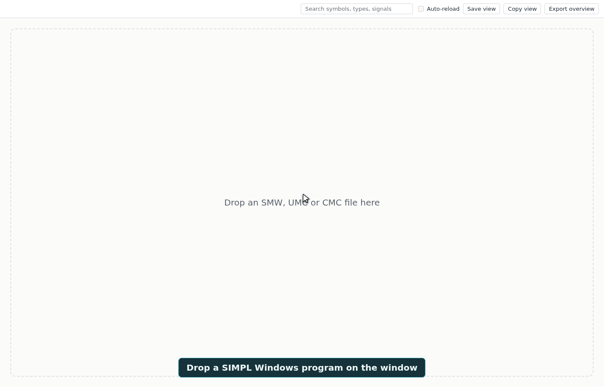

<p align="center">
  
</p>

<h1 align="center">SMW Program Map</h1>

<p align="center">
  A desktop app for reading Crestron SIMPL Windows programs.<br>
  See a whole program as one zoomable map, find any symbol, and follow <em>any</em> signal to everywhere it goes.
</p>

<p align="center">
  <a href="LICENSE"></a>
  
  
  
</p>



## Contents

- [Why](#why)
- [Features](#features)
- [Install](#install)
- [Using it](#using-it)
  - [Opening a program](#opening-a-program)
  - [Moving around the map](#moving-around-the-map)
  - [Following a signal](#following-a-signal)
  - [Searching](#searching)
  - [Auto-reload](#auto-reload)
  - [Saving images](#saving-images)
- [Privacy and network use](#privacy-and-network-use)
- [Known limitations](#known-limitations)
- [Building from source](#building-from-source)
- [Credits](#credits)
- [License](#license)

## Why

A SIMPL Windows program is edited one folder at a time, so it is hard to see how the whole thing fits together or
where a signal ends up once it leaves the symbol in front of you.

SMW Program Map reads the program file and draws all of it at once: every folder, module and symbol, nested the way
the program is organized, with the signals between them. Zoom out for the shape of the system, zoom in for individual
pins, and click a signal to see every place it appears.

## Features

- **The whole program on one map.** Folders, modules and symbols are drawn as nested boxes, with more detail appearing
  as you zoom in.
- **Pins and where they go.** Each symbol shows its inputs and outputs, along with where each signal comes from or
  goes to. Crowded symbols open a full list of their pins.
- **Signal tracing.** Click a connected pin to highlight that signal's path across the program and list every place it
  appears. Click a place in the list to fly to it.
- **Search.** Find symbols, symbol types and signals by name.
- **Auto-reload.** Tick one box and the map follows the file as it is saved, keeping your place.
- **Images to share.** Save or copy the current view, or export an overview of the whole program as a PNG up to
  8192 px on its longest side.
- **Read-only.** The app never changes the file you open.

## Install

There is no published release yet. To run the app, see [Building from source](#building-from-source).

| System | File | Notes |
| --- | --- | --- |
| Linux (x64) | `smw-program-map-<version>.AppImage` | `chmod +x` it and run it. No install needed. |
| Windows (x64) | `smw-program-map-<version>-setup.exe` | Unsigned unless built with a certificate: SmartScreen asks once (*More info*, then *Run anyway*). |
| macOS | `.dmg` and `.zip`, for Apple Silicon and Intel | Not notarized unless built with Apple credentials: right-click the app and choose *Open* the first time. |

## Using it

### Opening a program

Drop a `.smw`, `.umc` or `.cmc` file on the window, one at a time. Large programs show their progress while they are
read and arranged.

### Moving around the map

| Action | Control |
| --- | --- |
| Zoom | Mouse wheel |
| Pan | Drag with the left button |
| See every pin on a crowded symbol | Click the row after the last pin shown |

### Following a signal

Click a connected pin. The signal's path is highlighted, everything else fades, and a panel lists each place the
signal appears. Click a place to fly to it. Press **Esc**, or click an empty part of the map, to clear the highlight.

### Searching

Type in the search box to find symbols, types and signals. Choosing a result takes you to it. Choosing a type lists
every symbol of that type.

### Auto-reload

Tick **Auto-reload** after opening a file. When the file is saved, the map updates within about two seconds and stays
where you were looking. A highlighted signal is cleared, because it may no longer exist in the new version. If the new
version cannot be read, a message appears and the last good map stays on screen. The setting is off each time the app
starts.

### Saving images

**Save view** writes what is on screen to a PNG, **Copy view** puts it on the clipboard, and **Export overview** saves
the whole program as a single image.

## Privacy and network use

There is no account, no telemetry and no update check. The app blocks every web request it would otherwise make, so
your programs stay on your machine. It reads only the file you drop on it and writes only the images you ask it to
save.

## Known limitations

- **Unsigned builds.** Without certificates, SmartScreen and Gatekeeper ask once on first launch (see
  [Install](#install)).
- **Files must be dropped.** There is no Open dialog, and the app does not register itself for `.smw` files.
- **Protected files** are detected but cannot be displayed.
- **Viewing only.** Programs cannot be edited here.

## Building from source

Requires Node.js 22.13 or later. The app is in `app/`.

```sh
cd app
npm ci
npm run dev          # the app with hot reload
npm test             # unit and integration tests (Vitest)
npm run e2e          # end-to-end tests against the built app (Playwright; xvfb-run on a headless Linux)
npm run typecheck
```

Release builds, which install from the lockfile, run the type check and the tests, package, and print each artifact's
size and SHA-256:

```sh
scripts/build/build-linux.sh                                               # AppImage, on Linux
scripts/build/build-macos.sh                                               # dmg + zip, x64 and arm64, on a Mac
powershell -ExecutionPolicy Bypass -File scripts\build\build-windows.ps1   # NSIS installer, on Windows
```

From Linux, `npm run build:win` (needs Wine) and `npm run build:mac` (an unsigned x64 zip) cross-build the other two.
Output goes to `app/dist/`. Signing is optional; each script's header lists the certificate and notarization settings
it reads.

`app/build/icon.svg` is the only source for the icon. After changing it, run `npm run icon` (needs `rsvg-convert`) to
regenerate the PNG and ICO files.

Two developer tools are in `app/tools/`. Real programs can contain client and site names, so use `sanitize.ts` before
sharing one or adding it as a test fixture.

```sh
npx tsx tools/sanitize.ts <input> <output>  # copy a program with its names replaced by invented ones
npx tsx tools/bench.ts <folder>             # time the load pipeline; prints numbers only, no names or paths
```

The code is TypeScript throughout: an Electron shell, a worker that loads each program off the main thread, a
renderer that draws the map with PixiJS, and a core library (file parser, program model, connections, ELK-based
layout, search) that is tested on its own.

## Credits

The idea for this program was sparked by
[Crestron-Python-Graph](https://github.com/philiplawall/Crestron-Python-Graph) by
[philiplawall](https://github.com/philiplawall).

## License

[MIT](LICENSE) © 2026 Stephen Genusa
